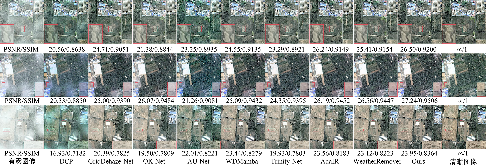
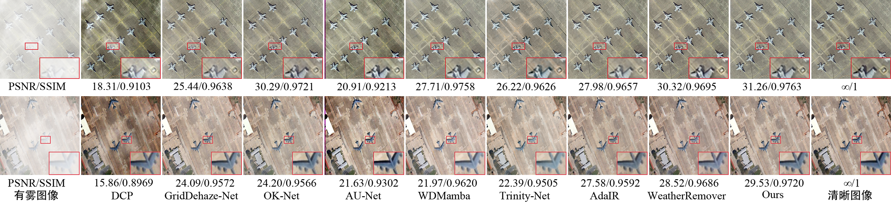
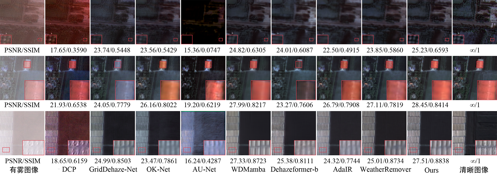
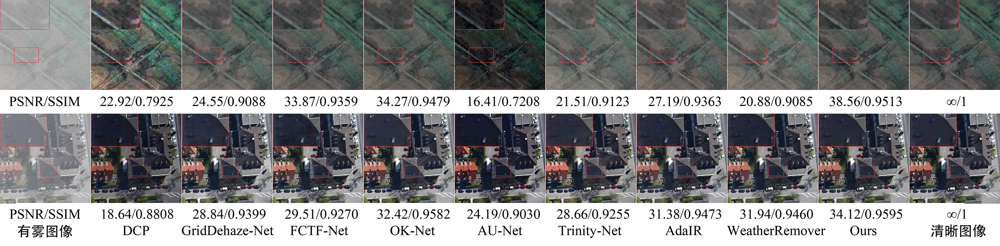
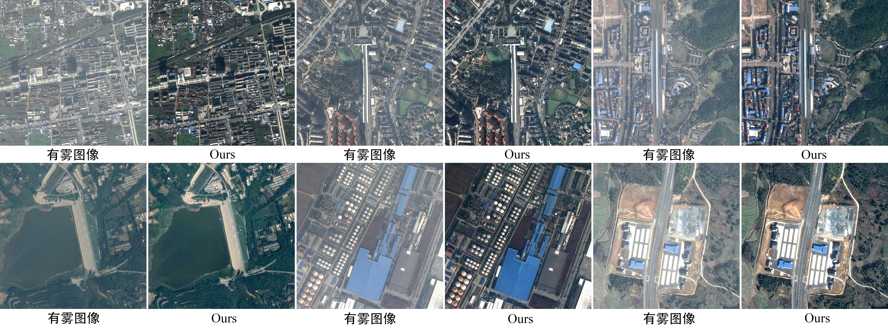

# 基于低秩上下文建模与双域协同融合的遥感图像去雾方法

## 网络架构图

##  结果可视化

点击展开全部去雾可视化对比图

---

##  入门

我们使用 **PyTorch 2.7.1 + CUDA 12.8** 和 NVIDIA RTX 5090 GPU 对代码进行训练和测试。详细配置信息请参见论文。

---

##  可用资源

以下是模型检查点的下载链接：
- 🔹 **SateHaze1k**  
[📥 Download](https://pan.baidu.com/s/12jl2jqlFqd4c5BSEM-P9rw?pwd=r2a7)
- 🔹 **HRSD**  
[📥 Download](https://pan.baidu.com/s/14KPqTb4g-OKQxr12JDI1zQ?pwd=avju)
- 🔹 **RRSHID**  
[📥 Download](https://pan.baidu.com/s/16ks7wDWh38PmADUZO5Zykw?pwd=fy6b)

---

##  邮箱
如有任何疑问，请随时联系我们：
✉️ binwang@ahut.edu.cn
